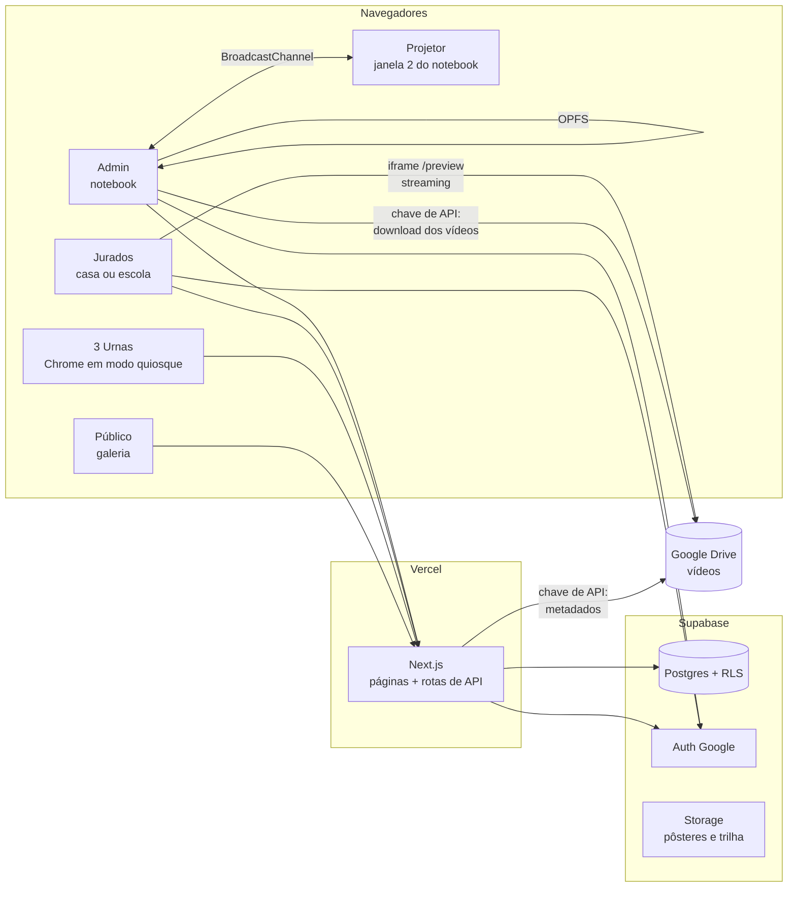

# 2 · Arquitetura e stack

## Stack

| Camada | Tecnologia | Por quê |
|---|---|---|
| Front-end + API | **Next.js (App Router, TypeScript)** | Páginas e rotas de servidor (Route Handlers e Server Actions) no mesmo projeto |
| Hospedagem | **Vercel** (plano Hobby) | Deploy por push, HTTPS e previews automáticos |
| Banco | **Supabase Postgres** | Relacional (bom para notas e rankings), funções SQL atômicas para o voto, RLS |
| Login | **Supabase Auth + Google OAuth** | Login com o Google da escola para admin e jurados |
| Arquivos pequenos | **Supabase Storage** | Pôsteres e faixas da trilha |
| Vídeos | **Google Drive** (pasta pública na conta do admin) + **Drive API com chave de API** | Streaming para jurados, download para o telão, metadados |
| Offline do telão | **PWA (service worker) + OPFS** | App e arquivos grandes guardados no navegador do notebook |
| Telão em 2 janelas | **BroadcastChannel** | Painel e projetor conversam sem rede |
| Áudio | **Web Audio API** | Crossfade, volume e silenciar |
| UI | Tailwind CSS + componentes próprios | Visual do protótipo (tema "Classics") |
| Cartões | Página HTML com CSS de impressão (15 por A4) | 90 a 120 cartões por cerimônia |

## Visão geral



## Componentes

### Aplicação Next.js

Rotas por perfil:

| Rota | Perfil | Observações |
|---|---|---|
| `/admin/**` | Admin | Cadastro, júri, votação, cerimônia, galeria |
| `/juri/**` | Jurado | Lista de filmes, player com notas |
| `/urna` | Urna pareada | Tela de quiosque, sem login de pessoa |
| `/telao/painel/[cerimonia]` | Admin | Painel de controle (notebook) |
| `/telao/projetor/[cerimonia]` | Admin | Aberta pelo painel com `window.open`, vai para a segunda tela |
| `/galeria/[edicao]` | Público | Página estática (ISR), revalidada quando o admin muda a liberação |

Lógica sensível (voto, notas, galeria, resultados) roda **no servidor**, em Route Handlers e Server Actions ou em funções SQL. O navegador nunca recebe a chave `service_role`.

### Supabase

- **Postgres:** todas as entidades (ver [Modelo de dados](04-modelo-de-dados.md)). Regras críticas em funções SQL `security definer`, como `cast_vote` e `close_voting`.
- **RLS ligado em todas as tabelas.** Jurado lê e escreve só as próprias notas. Admin acessa tudo. O público lê só a view da galeria.
- **Auth:** provedor Google. Jurados precisam ter e-mail `@colegioprogresso.g12.br` (conferido no servidor) e estar na lista da edição. Admins entram pela lista `staff`, com qualquer conta Google (o admin principal usa Gmail).
- **Storage:** bucket `posters` (leitura pública só para filmes liberados, servida via URL assinada) e bucket `soundtrack` (privado).

### Google Drive

| Uso | Como |
|---|---|
| Cadastro | O admin **cola o link de compartilhamento** do vídeo; o sistema extrai o `fileId` e confere se o arquivo está acessível |
| Jurado assiste | Iframe `https://drive.google.com/file/d/{id}/preview`. Funciona sem login no Google, porque o arquivo é público por link |
| Telão baixa | O navegador do admin chama `GET https://www.googleapis.com/drive/v3/files/{id}?alt=media&key={API_KEY}` e grava o arquivo em streaming no OPFS. O vídeo não passa pela Vercel |
| Metadados | `size`, `md5Checksum`, `videoMediaMetadata.durationMillis`, lidos pela mesma chave ao cadastrar o filme |

**Pré-requisitos:**
- Os vídeos ficam numa **pasta do Drive do admin**, compartilhada como "qualquer pessoa com o link: leitor".
- Um **projeto no Google Cloud** na conta do admin, com: cliente OAuth (só os escopos básicos `email` e `profile`, que não exigem verificação do Google) e uma **chave de API** limitada à Drive API e ao domínio da plataforma.
- Não há conta de serviço nem escopo de Drive no login.

**Consequência:** como os arquivos são públicos por link, a galeria "bloqueada" significa **escondida na plataforma**, não trancada no Drive. Quem tiver o link do arquivo consegue assistir. Ver [Segurança e privacidade](07-seguranca-privacidade.md).

### Tempo real

O contador de votos do painel e do telão consulta `GET /api/cerimonias/{id}/contagem` a cada **3 segundos**. São no máximo 2 clientes por cerimônia, uma carga desprezível, e o polling é mais simples e resistente a quedas que o Realtime. Se a rede cair, o contador mostra o último valor com a marca "desatualizado".

## Estrutura do repositório (proposta)

```
/
├─ docs/                      ← esta documentação
├─ app/
│  ├─ (publico)/galeria/
│  ├─ admin/
│  ├─ juri/
│  ├─ urna/
│  ├─ telao/{painel,projetor}/
│  └─ api/
├─ lib/
│  ├─ supabase/               ← clientes do navegador e do servidor
│  ├─ drive/                  ← Drive API: link → fileId, metadados
│  ├─ offline/                ← OPFS: download, verificação, leitura
│  ├─ ceremony/               ← montagem do roteiro (passos)
│  └─ audio/                  ← motor da trilha (Web Audio)
├─ supabase/
│  ├─ migrations/             ← SQL versionado (tabelas, views, RLS, funções)
│  └─ seed.sql                ← dados de exemplo para desenvolvimento
├─ public/sw.js               ← service worker (cache do telão)
└─ tests/                     ← regras de negócio e e2e
```

## Ambientes

| Ambiente | Onde | Banco |
|---|---|---|
| Local | `next dev` | Projeto Supabase **cloud** (sem Supabase local, para acelerar o MVP) |
| Produção | Vercel, começa em `*.vercel.app`; domínio próprio apontado depois | O mesmo projeto Supabase cloud |

Migrations em `supabase/migrations/`, aplicadas com `npx supabase db push --linked`. Tipos do banco: `npx supabase gen types typescript --linked > lib/database.types.ts`.

Todas as contas (Vercel, Supabase, Google Cloud, Drive) ficam no Gmail do admin. Da escola, só se usa o domínio dos e-mails dos jurados.

Variáveis de ambiente (ver `.env.example`): `NEXT_PUBLIC_SUPABASE_URL`, `NEXT_PUBLIC_SUPABASE_PUBLISHABLE_KEY`, `SUPABASE_SECRET_KEY`, `NEXT_PUBLIC_GOOGLE_API_KEY` (restrita por domínio), `VOTE_CODE_PEPPER`. O domínio dos jurados fica no banco (`editions.juror_email_domain`), não em variável.

Ao apontar o domínio próprio: adicionar o novo endereço nas URLs de redirecionamento do Supabase Auth, no cliente OAuth e na restrição da chave de API.

## Limites dos planos gratuitos (conferir)

| Serviço | Ponto de atenção | Situação no festival |
|---|---|---|
| Vercel Hobby | Uso não comercial; limites de funções | Atividade escolar; os vídeos não passam pela Vercel |
| Supabase Free | Projeto **pausa após 7 dias sem uso**; 500 MB de banco; 1 GB de Storage | Manter o projeto ativo na semana do evento; pôsteres e trilha somam menos de 100 MB |
| Drive API | Cotas por usuário e por minuto | Poucas dezenas de chamadas |
