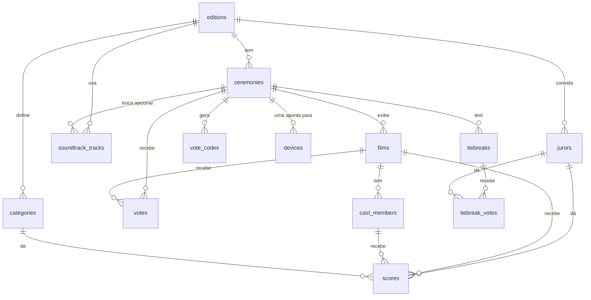

# 4 · Modelo de dados

Banco: Supabase Postgres. Chaves `uuid` (`gen_random_uuid()`), datas em `timestamptz`. As migrations ficam em `supabase/migrations/`.

## Diagrama



## Tabelas

### `editions`
| Coluna | Tipo | Notas |
|---|---|---|
| id | uuid PK | |
| name | text | "Film Festival 2026 – Classics Edition" |
| year | int | |
| event_date | date | 2026-11-24 |
| venue | text | "Biblioteca" |
| is_active | bool | Só uma ativa por vez (índice único parcial) |
| jury_status | enum `open \| closed` | Avaliação do júri aberta ou encerrada |
| gallery_enabled | bool | Padrão `false` |

### `ceremonies`
| Coluna | Tipo | Notas |
|---|---|---|
| id | uuid PK | |
| edition_id | uuid FK | |
| name / short_name | text | "Junior Premiere – manhã" / "Junior manhã" |
| starts_at / ends_at | timestamptz | |
| audience | text | "6th e 7th" |
| code_prefix | text | `JM`, `SR`, `JT`. Único na edição |
| sort_order | int | |
| voting_status | enum `not_started \| open \| closed` | |
| voting_opened_at / voting_closed_at | timestamptz | |

### `films`
| Coluna | Tipo | Notas |
|---|---|---|
| id | uuid PK | |
| ceremony_id | uuid FK | A edição vem pela cerimônia |
| title | text | |
| class_name | text | Turma, por exemplo "8th A" |
| synopsis | text | Sinopse curta (urna, galeria) |
| drive_file_id | text | Extraído do link colado pelo admin |
| video_key | text | Caminho do vídeo no R2 (`films/{id}/{aleatório}.mp4`). Se existir, júri e telão usam o R2; senão, o Drive |
| size_bytes / duration_ms / md5 | bigint / int / text | Lidos da Drive API ao cadastrar |
| poster_path | text | Caminho no Storage |
| screening_order | int | Ordem de exibição na cerimônia |
| is_public | bool | Padrão `false` |

### `cast_members`
| Coluna | Tipo | Notas |
|---|---|---|
| id | uuid PK | |
| film_id | uuid FK | |
| student_name | text | Só o primeiro nome, ou nome curto (minimização) |
| role_name | text | Personagem |
| is_evaluated | bool | Concorre a atuação |
| acting_category | enum `actress \| actor` nullable | Obrigatório se `is_evaluated` |

### `categories`
| Coluna | Tipo | Notas |
|---|---|---|
| id | uuid PK | |
| edition_id | uuid FK | |
| code | text | `scr`, `cos`, `cin`, `actress`, `actor`, `pic`, `pc` |
| name_en / name_pt | text | "Best Screenplay" / "Melhor Roteiro" |
| kind | enum `film \| acting \| public` | |
| acting_category | enum nullable | Para `kind = acting` |
| award_order | int | 1 = Roteiro … 7 = People's Choice |

### `staff` e `jurors`
| Tabela | Colunas |
|---|---|
| `staff` | id, email (único), name, role (`admin`), user_id nullable |
| `jurors` | id, edition_id, email, name, user_id nullable; único (edition_id, email) |

### `scores`
Uma nota por jurado, por alvo e por categoria.

| Coluna | Tipo | Notas |
|---|---|---|
| id | uuid PK | |
| juror_id | uuid FK | |
| category_id | uuid FK | Para atuação: a categoria do integrante (atriz ou ator) |
| film_id | uuid FK | Sempre preenchido (facilita as consultas) |
| cast_member_id | uuid FK nullable | Preenchido só em atuação |
| value | numeric(3,1) | `check (value between 0 and 10 and value * 2 = trunc(value * 2))` |
| updated_at | timestamptz | |

Único: `(juror_id, category_id, film_id, coalesce(cast_member_id, '00000000-…'))`. Um trigger impede gravar com `editions.jury_status = 'closed'`.

### Votação
| Tabela | Colunas | Notas |
|---|---|---|
| `vote_codes` | id, ceremony_id, code_hash, batch (`A\|B\|C\|D`), used_at, used_device_id | `code_hash = sha256(pepper ‖ código)`. O código em texto claro só existe na geração do PDF |
| `votes` | id, ceremony_id, film_id, device_id, created_at | **Sem ligação com o código**: anonimato |
| `devices` | id, label, ceremony_id, token_hash, pairing_code_hash, pairing_expires_at, revoked_at | Urnas |

### Desempate do júri
| Tabela | Colunas |
|---|---|
| `tiebreaks` | id, ceremony_id, category_id, tied_refs (jsonb: ids de filmes ou integrantes), status (`open \| decided`), winner_ref, method (`majority \| casting_vote`), decided_by, decided_at |
| `tiebreak_votes` | tiebreak_id, juror_id, choice_ref; PK (tiebreak_id, juror_id) |

### Trilha e auditoria
| Tabela | Colunas |
|---|---|
| `soundtrack_tracks` | id, edition_id, ceremony_id nullable (troca só naquela cerimônia), cue (`abertura \| bastidores \| ambiente \| suspense \| fanfarra \| fanfarra_pc \| encerramento`), storage_path, file_name, size_bytes |
| `audit_log` | id, actor_user_id, action, entity, entity_id, details jsonb, at |

## Views de resultado (só admin)

- `v_jury_scores`: média por (cerimônia, categoria, alvo) = `avg(value)` **só entre os jurados que deram nota**, mais `count(*)` de jurados.
- `v_jury_ranking`: ranking por cerimônia e categoria, com `rank()` para detectar empate no 1º lugar.
- `v_public_ranking`: votos por filme e desempate em cascata (ver [Regras de negócio](05-regras-de-negocio.md)).
- `v_ceremony_results`: vencedor e até 3 indicados por categoria, já considerando os `tiebreaks` decididos. É o que o telão baixa.
- `v_gallery`: filmes com `is_public` e `gallery_enabled`, com os prêmios. É a **única** fonte da página pública.

## Função crítica: `cast_vote`

```sql
create function cast_vote(p_device uuid, p_code text, p_film uuid)
returns text  -- 'ok' | 'invalid' | 'used' | 'other_ceremony' | 'closed'
language plpgsql security definer as $$
declare v_cer uuid; v_code_id uuid;
begin
  select ceremony_id into v_cer from devices
   where id = p_device and revoked_at is null;
  if not exists (select 1 from ceremonies where id = v_cer and voting_status = 'open')
    then return 'closed'; end if;
  if not exists (select 1 from films where id = p_film and ceremony_id = v_cer)
    then return 'invalid'; end if;

  -- queima atômica: só um UPDATE vence, mesmo com duas urnas ao mesmo tempo
  update vote_codes set used_at = now(), used_device_id = p_device
   where code_hash = hash_code(p_code) and ceremony_id = v_cer and used_at is null
   returning id into v_code_id;

  if v_code_id is null then
    if exists (select 1 from vote_codes where code_hash = hash_code(p_code) and ceremony_id = v_cer)
      then return 'used'; end if;
    if exists (select 1 from vote_codes where code_hash = hash_code(p_code))
      then return 'other_ceremony'; end if;
    return 'invalid';
  end if;

  insert into votes (ceremony_id, film_id, device_id) values (v_cer, p_film, p_device);
  return 'ok';
end $$;
```

O código é validado duas vezes: ao digitar (`check_code`, só leitura, para liberar a cédula) e ao confirmar (`cast_vote`, que queima e grava na mesma transação).
