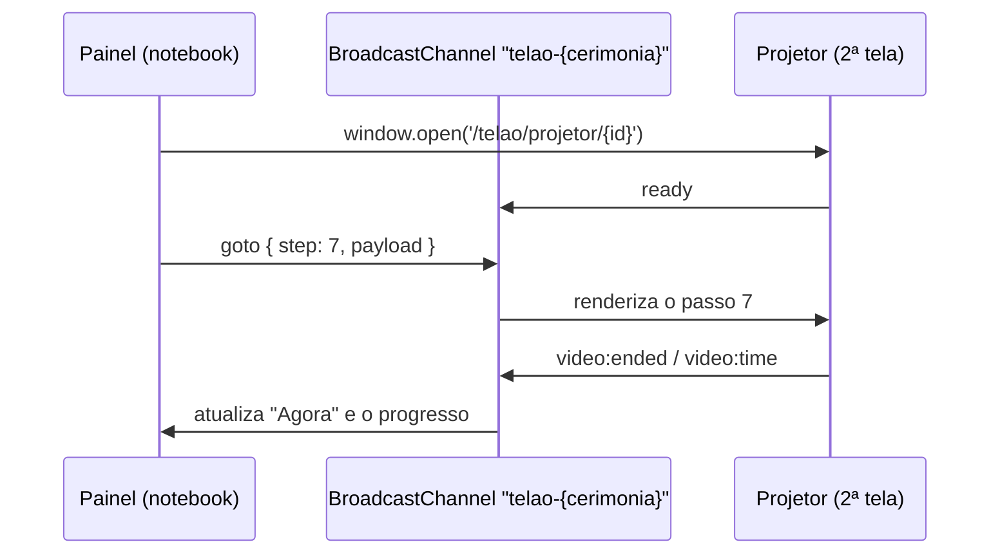

# 6 · Telão, offline e trilha sonora

## Duas janelas



- O **painel** é a fonte da verdade: guarda o índice do passo e manda o projetor renderizar. Teclas `→`/`PageDown`/`Espaço` avançam, `←`/`PageUp` voltam e `M` silencia. Funciona com passador de slides, que emula essas teclas.
- O **projetor** só desenha e toca. Recebe apenas o que vai mostrar: nada de notas e nada de vencedor antes do passo "vencedor".
- O painel abre o projetor com `window.open`. Com a **Window Management API** do Chrome (`getScreenDetails`), o projetor já abre em tela cheia na segunda tela. Se a permissão for negada, basta arrastar a janela e apertar F11.
- Se o projetor fechar ou recarregar, ele manda `ready` e o painel reenvia o passo atual.
- O estado do painel (passo, cerimônia) fica em `sessionStorage`, para sobreviver a um F5.

### Mensagens

| Tipo | Direção | Conteúdo |
|---|---|---|
| `ready` | projetor → painel | — |
| `goto` | painel → projetor | `step`, `kind`, dados para renderizar (pôster, títulos, indicados ou vencedor) |
| `video:play` / `video:pause` / `video:seek` | painel → projetor | Controle manual do filme |
| `video:time` / `video:ended` | projetor → painel | Progresso; ao terminar, o painel sugere avançar |
| `count` | painel → projetor | Total de votos (o painel faz o polling e repassa) |
| `audio` | — | O áudio toca **no painel**, que tem a saída de som do notebook. Ver abaixo |

> **Áudio do filme × trilha:** os dois saem pela mesma placa de som do notebook (HDMI ou caixa). O vídeo toca na janela do projetor; a trilha, no painel. Com o filme em execução, a trilha está sempre em silêncio.

## Preparação offline (véspera)

Admin → Cerimônia → **Baixar filmes**, no notebook do telão, em Chrome.

1. Pede `navigator.storage.persist()` para o navegador não apagar os arquivos e confere `navigator.storage.estimate()`. Precisa de cerca de **5 GB livres** para as 3 cerimônias.
2. Para cada filme: `fetch("/api/video/{filmId}")`, que redireciona para um link assinado do **R2** (se o filme ainda não estiver no R2, cai no Drive com `alt=media&key={API_KEY}`, sujeito à cota de downloads) → `response.body` lido em blocos → `FileSystemWritableFileStream` no **OPFS** (`/films/{filmId}.mp4`). Mostra o progresso por arquivo e o total.
3. **Verificação:** compara o tamanho com `size_bytes`; abre o arquivo num `<video>` oculto e confere `duration` contra `duration_ms` (tolerância de 1 s); faz `seek` para perto do fim e confere que decodifica. Se falhar, baixa de novo.
4. Trilha: baixa as faixas do Storage (as que valem para aquela cerimônia) para `/soundtrack/{cue}.mp3`.
5. **Snapshot da cerimônia:** a página do painel já traz os resultados do júri, os textos e os pôsteres. O service worker (`public/sw.js`) guarda a última cópia de `/telao/*` (rede primeiro, cópia sem rede) e os arquivos do app (`/_next/static`, cache primeiro). Por isso é preciso **abrir o modo apresentação uma vez com internet**, depois de baixar. O resultado do People's Choice só entra no dia, ao encerrar a votação.
6. Um **teste offline** desliga a rede (DevTools ou cabo) e abre o modo apresentação.

O que exige internet no dia: o **contador de votos** e o **resultado do People's Choice**. As urnas precisam de internet de qualquer forma.

### Reprodução
- O projetor lê o arquivo com `opfsRoot.getFileHandle(...).getFile()` e toca via `URL.createObjectURL(file)`. Sem rede e sem streaming.
- Se o arquivo não existir no OPFS, o painel mostra um aviso vermelho e oferece: (a) tocar do Drive (online) ou (b) **escolher um arquivo local** (pendrive) com `<input type=file>`.

## Plano B

| Falha | Ação |
|---|---|
| Internet cai durante a cerimônia | O telão continua (offline). O contador mostra "desatualizado". Ao encerrar a votação, o admin usa o 4G do celular como roteador para buscar o resultado |
| Urnas sem internet | Sem votação em papel (decidido). Ligar as urnas no 4G de um celular como roteador; a votação espera a conexão voltar |
| OPFS vazio ou corrompido | Escolher o arquivo do pendrive no próprio painel |
| Notebook trava | Segundo notebook já preparado na véspera (download feito nos dois), ou VLC com os arquivos do pendrive e slides de reserva em PDF |
| Projetor não reconhece a 2ª tela | Modo espelhado: abrir só o projetor em tela cheia e controlar pelo teclado; o painel fica no celular do admin (`/telao/painel` funciona online) |

## Motor da trilha (Web Audio)

```
AudioContext
 └─ master (GainNode: volume e silenciar)
     └─ DynamicsCompressor → destino
 cue atual:  <audio src=blob:OPFS> → MediaElementSource → bus (GainNode) → master
```

- Mudança de passo → `cueFor(step)` → se a faixa for diferente da atual, faz crossfade: o bus antigo vai a 0 em 1,2 s e o novo sobe de 0 a 1 (2,5 s no `suspense`).
- Faixas "uma vez" (`abertura`, `fanfarra`, `fanfarra_pc`) passam sozinhas para `ambiente` no `ended`.
- Faixas em loop usam `audio.loop = true`.
- O `AudioContext` só nasce no primeiro gesto do usuário (política de autoplay). O painel mostra "Clique para ativar o som" até isso acontecer.
- Cada momento toca o arquivo enviado em Admin → Telão (baixado no OPFS; online, a URL assinada). Sem arquivo, toca o **exemplo sintetizado** no navegador (o mesmo da prévia), que funciona offline.

## Implementação
- `lib/telao.ts`: roteiro, indicados (top 3 + sorteio fixo), o que o projetor recebe (`View`) e mensagens.
- `lib/telao-server.ts`: monta o show da cerimônia (júri, PC, pôsteres, faixas).
- `app/telao/[id]` painel · `app/telao/[id]/projetor` projetor · `app/admin/telao` download e trilha.
- `lib/opfs.ts` (arquivos locais) · `lib/soundtrack.ts` (motor da trilha).
